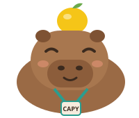

<p align="center"></p>

<h1 align="center">Capy Pals 🦫🍋</h1>
<p align="center"><b>Capy is friends with everyone. It finds the people at the conference who already solved your problem — with receipts.</b><br>
Patch the Conference Hackathon · FalkorDB × Bright Data × TrueForge + OpenAI</p>

---

Conferences are full of people who have already solved your problem — you just can't find them.
GitHub Universe 2026 has **162 sessions and 183 speakers** in two days. Capy reads all of it, works out
**who solved what**, tells you **where to catch them**, **remembers who you met**, and drafts a follow-up
that only goes out **after you approve it**.

> Demo persona: **Maya Chen** (fictional), platform lead at a fintech. Her team's AI agents open pull
> requests faster than anyone can review them. *Who here already solved that?*

## What it does (the demo flow)

1. **"Who should I meet?"** → Capy (a TrueForge agent on `gpt-6-luna`) searches the FalkorDB graph and
   returns the top people, each with a **receipt** (their own words + source + when it was fetched) and
   the **session, time and room** to catch them. The Capy panel **lights up the graph path** behind each pick.
2. **"Plan my two days so I can catch all three."** → Capy runs a script in a **TrueForge sandbox (Code Mode)** that
   calls the graph tools for each person, sorts by time and flags clashes.
3. **"I just bumped into Andy Kelly — what do we have in common?"** → **live Bright Data lookup**
   (identity → fresh profile fetch), added to the graph incrementally, common ground computed.
4. **"Remember I met David…"** → memory written to the graph. Next morning, **a brand-new session still
   knows** who you met and who's waiting on a follow-up.
5. **"Draft a follow-up to David and send it."** → grounded in the receipt; **TrueForge pauses for human
   approval** before `send_intro` runs.

## How each sponsor powers it

### FalkorDB — the graph is the product
- **GraphRAG SDK** ingests every talk abstract and speakers' LinkedIn posts (OpenAI extraction) into a
  typed knowledge graph: `Person`, `Organization`, `Problem`, `Practice`, `Tool`, linked by
  `SOLVED`, `FACES`, `PRACTICES`, `BUILT`, `USES`, `ADDRESSES`, `WORKS_AT` — with the SDK's provenance
  chain `Document → Chunk ← MENTIONED_IN ← Entity` ([`scripts/build_graph.py`](scripts/build_graph.py)).
- **Multi-hop + vector, in one place** ([`capy/match.py`](capy/match.py)): your problem → vector index over
  entity embeddings → similar problems/practices (materialised as `SIMILAR_TO` edges) → the `Speaker` who
  `SOLVED`/`BUILT`/`PRACTICES` it (or 2 hops via `ADDRESSES`) → `PRESENTS` → `Talk` (time, room).
  A chunk-vector path (`Chunk → Document ← AUTHORED ← Speaker`) backs it up.
- **Explainable**: every answer returns its path; the Capy panel renders it with **@falkordb/canvas**.
  Every hop is a real edge; every claim cites the chunk it came from.
- **Memory across sessions**: `(:Me)-[:MET {notes, where, follow_up}]->(:Person)`, `WANTS_TO_MEET`, `INTRO`.
- **Shared state between agents**: the chat agent writes `MET` edges; the scheduled `capy-followup`
  agent reads them every morning and drafts follow-ups.
- Graph today: **~2,400 entities, ~1,900 facts, 365 source documents, 162 talks.**

### Bright Data — fresh, hard-to-get data, with provenance on every fact
- **Browser API** (via the Bright Data MCP browser tools) renders the Universe session catalog — a
  JavaScript app paginated behind "Show more" — which returns an empty shell to plain HTTP
  ([`scripts/fetch_catalog.py`](scripts/fetch_catalog.py)).
- **SERP via Web Unlocker** resolves each speaker to their LinkedIn profile with a confidence score
  (name + company match): **124/183** resolved ([`scripts/research_speakers.py`](scripts/research_speakers.py)).
- **Scraper API** (`LinkedIn posts`, discover by profile URL, authored only) — one batched job → **227 recent posts**.
- **Live lookups** at the conference: identity from the graph or SERP → **Web Unlocker** fetch of the
  profile, falling back to the **LinkedIn profile Scraper API** if the page is thin → incremental GraphRAG ingest
  ([`capy/server.py` `lookup_person`](capy/server.py)). Only the person's own words are kept (About, posts,
  certifications, recommendations; sign-in/cookie chrome and reposts are stripped), and a re-lookup replaces the
  previous copy with GraphRAG `update` (a content-hash no-op when nothing changed). Capy then leads with what the
  fresh fetch added: the new facts, and the person's own sentence closest to your problem, as the first receipt.
- **Data quality**: every Document carries `source_url`, `collector` and `fetched_at`; receipts show them;
  failed records are kept and reported, retries with backoff, graceful "using what the graph already
  knows" when a live fetch fails; co-speaker de-duplication; an LLM rerank checks evidence relevance.

### TrueForge + OpenAI — the agent runtime
- **Agents** ([`scripts/setup_trueforge.py`](scripts/setup_trueforge.py), idempotent): `capy` (chat) and
  `capy-followup` (runs on a **daily 8:00 schedule**), both on **OpenAI `gpt-6-luna`**. OpenAI also does
  all GraphRAG extraction, embeddings (`text-embedding-3-small`) and reranking.
- **MCP tools**: our `capy-graph` server ([`capy/server.py`](capy/server.py), streamable HTTP) + the
  **Bright Data remote MCP**, discovered on demand (deferred tool loading).
- **Human approval**: `send_intro` is annotated destructive and listed in `require_approval_for_tools` —
  TrueForge shows the exact message and waits for **Allow / Deny**.
- **Sandbox / Code Mode** (Daytona): itinerary planning calls MCP tools from Python inside the sandbox.
- **Skill**: [`skills/capy-intro/SKILL.md`](skills/capy-intro/SKILL.md) — the receipt-grounded intro playbook.
- **Generative UI** cards, subagents and clarifying questions are enabled on the agent.

## Architecture

```
 Bright Data ── Browser API ─▶ session catalog ─┐
             ── SERP / Unlocker ─▶ identities ──┤      ┌───────────── FalkorDB ─────────────┐
             ── Scraper API ─▶ LinkedIn posts ──┴─────▶│ GraphRAG SDK (OpenAI extraction)   │
                                                        │ Document→Chunk←Entity ─RELATES→    │
   TrueForge (gpt-6-luna)                               │ Talk, Speaker, SIMILAR_TO, MET …   │
   ├─ capy agent ──── MCP ──▶ capy-graph server ──────▶│ vector + fulltext indexes          │
   │   approvals, sandbox, skill, Gen UI                └────────────────────────────────────┘
   ├─ capy-followup (8am schedule) ── MCP ──▶ same graph (shared state)
   └─ Bright Data remote MCP (live web)          Capy panel (web/) ◀─ /api/view: the lit path
```

## Run it

```bash
cp .env.example .env      # OpenAI, Bright Data, Daytona keys; FalkorDB Cloud host/port/user/password
./start.sh                # venv, FalkorDB (Cloud or local), loads the graph, starts capy-graph + TrueForge
```
- Capy panel: http://localhost:8001 (side-by-side layout: `/?side`) · TrueForge chat: http://localhost:8790
- **FalkorDB Cloud**: put the instance endpoint in `.env`; `start.sh` loads the prebuilt graph with
  `python -m scripts.graph_io load data/export/capy-graph.jsonl.gz` the first time (vectors and indexes included).
- Before a live demo: `python -m scripts.reset_demo` clears rehearsal meetings, intros and live lookups (the built graph stays).
- Rebuild the data from scratch: `python -m scripts.fetch_catalog && python -m scripts.research_speakers && python -m scripts.build_graph`.
- The `capy-intro` skill is imported from this repo by TrueForge, so it is only registered once the repo is
  public (setup checks and skips it until then; `CAPY_SKILL=off` disables it).
- Can't reach FalkorDB Cloud? Try `FALKORDB_TLS=true`, or set `FALKORDB_HOST=localhost` and `start.sh` runs a
  local FalkorDB (Docker, or the embedded build) and loads the same graph.

## Demo video
[`demo/`](demo/) builds it end to end from the **real running apps**: ElevenLabs narration
([`narrate.py`](demo/narrate.py)) → Playwright drives the TrueForge chat and the Capy panel
([`record.cjs`](demo/record.cjs)) → ffmpeg fast-forwards only the waiting and adds captions ([`assemble.py`](demo/assemble.py)).

## Privacy & honesty
- Only **public** data about **conference speakers** (session catalog, public LinkedIn posts/profiles).
  Scraped data is kept out of this repo.
- Maya is a **fictional** persona; meeting notes in the demo are hers. Messages go to a **demo outbox** —
  and only after explicit approval.

Built in one day at the Patch the Conference Hackathon (Bright Data, San Francisco, Oct 24 2026).
