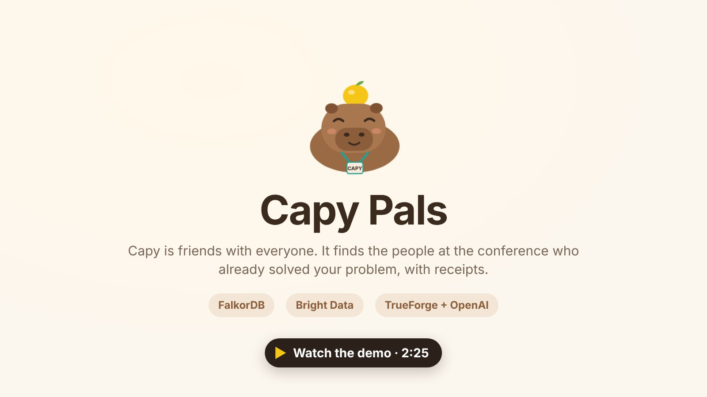
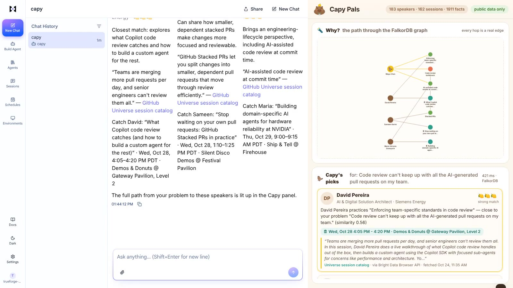
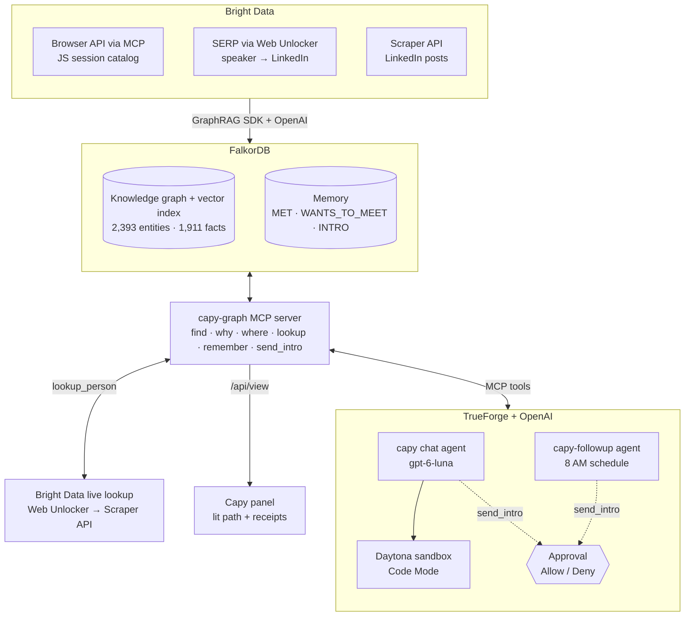
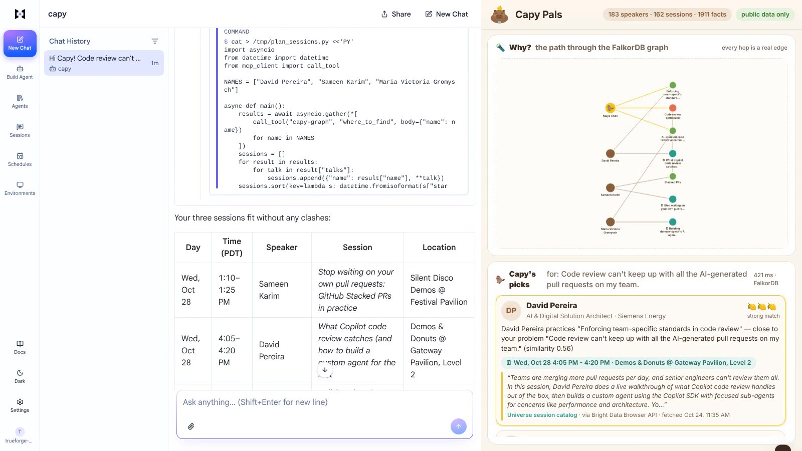
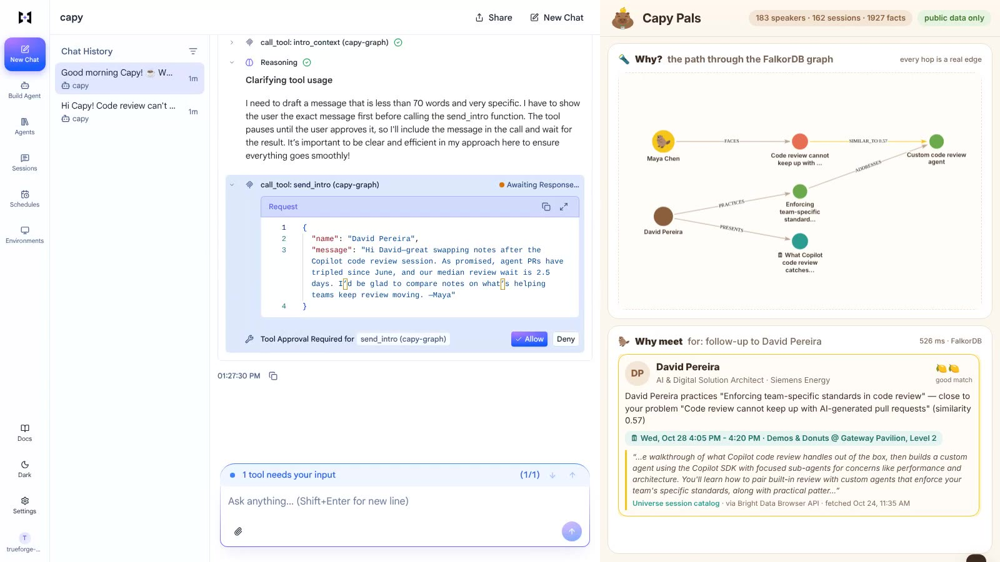

<p align="center"></p>

<h1 align="center">Capy Pals 🦫🍋</h1>
<p align="center"><b>Meet the people at the conference who already solved your problem, with receipts.</b><br>
Patch the Conference Hackathon · built on <b>FalkorDB</b>, <b>Bright Data</b> and <b>TrueForge + OpenAI</b></p>

Capy Pals is a capybara agent that turns a conference's sessions and speakers into a knowledge graph of who solved what. Tell Capy your problem and it finds the speakers who already solved it, shows the receipts (their own words, the source, and when it was fetched), and tells you exactly where to catch them. When you bump into someone, Capy looks them up live and finds what you have in common; it remembers everyone you met, and a morning agent drafts follow-ups that only go out after you approve them. We built it for GitHub Universe 2026: 162 sessions, 183 speakers, one graph.

## 🎬 Demo video (2:25)

<a href="https://www.youtube.com/watch?v=2iBrMS7ulGM"></a>

**https://www.youtube.com/watch?v=2iBrMS7ulGM** · every scene is a real recording of the running apps (also in the repo: [`demo/capy-pals-demo.mp4`](demo/capy-pals-demo.mp4)).

## The problem

Conferences are full of people who have already solved your problem, and you never find them. GitHub Universe 2026 packs **162 sessions and 183 speakers** into two days. Working out which three are worth your time means hours of reading abstracts and LinkedIn; the hallway conversations blur together by the next morning; and the follow-ups you promised never get sent. Attendees lose the best part of the conference, speakers miss the people who needed them most, and organisers have no way to make those introductions.

## Our solution

Capy does the hallway track for you. Our demo persona, **Maya Chen** (fictional), leads platform engineering at a fintech whose AI agents open pull requests faster than anyone can review them:

| Maya says | Capy does | Powered by |
|---|---|---|
| *"Code review can't keep up with all the AI-generated pull requests on my team. Who here already solved that?"* | Walks the graph from her problem to similar problems to the speakers who solved them, lights up that path, and shows each pick's receipt and where to catch them | FalkorDB · Bright Data · TrueForge |
| *"Plan my two days so I can catch all three."* | Writes and runs a sandbox script that pulls each person's sessions through the graph tools, sorts them and checks for clashes | TrueForge sandbox (Code Mode) |
| *"I just bumped into Andy Kelly at the badge party! Look Andy up fresh."* | Fetches the public profile live, adds it to the graph, and leads with what's new: Andy's own words, matched to Maya's problem | Bright Data → FalkorDB |
| *"Remember that I met David Pereira…"* (next morning, brand-new chat) | Remembers across sessions and knows who is still waiting on a follow-up | FalkorDB memory |
| *"Draft a follow-up to David and send it."* (or the 8 AM schedule) | Drafts it from the receipt; nothing is sent until Maya clicks **Allow** | TrueForge approvals + schedule |

<p align="center"><br>
<sub>Left: Capy in the TrueForge chat. Right: the Capy panel, with the path through the FalkorDB graph and each pick's receipt (source · collector · fetched-at).</sub></p>

## Sponsors at a glance

| Sponsor | Role in Capy Pals | What we used |
|---|---|---|
| **FalkorDB** | The brain: the knowledge graph of who solved what, the user's memory, and the state shared between agents | GraphRAG SDK (ingest, `update`, `delete_document`), vector + fulltext indexes, multi-hop Cypher, @falkordb/canvas, FalkorDB Cloud |
| **Bright Data** | The eyes: fresh, hard-to-get data with provenance on every fact | Browser API (via the Bright Data MCP), SERP via Web Unlocker, Scraper API (LinkedIn posts and profiles), Web Unlocker live fetches |
| **TrueForge + OpenAI** | The agent: runs Capy with its tools, sandbox, skill, approvals and schedule | 2 agents on `gpt-6-luna`, MCP tools with deferred loading, tool approvals, Daytona sandbox (Code Mode), skill, schedule with Run now, Generative UI; OpenAI extraction, embeddings and rerank |

## Architecture



**Before the conference**, Bright Data collects the catalog, the speakers' identities and their recent posts, and the GraphRAG SDK (on OpenAI) turns them into a FalkorDB graph. **At the conference**, both TrueForge agents reach that graph through one MCP server ([`capy/server.py`](capy/server.py)). It answers with graph paths and receipts, runs live Bright Data lookups, and writes the user's memory, while the Capy panel ([`web/`](web/)) renders every answer's path as it happens.

---

## FalkorDB: the graph is the product

**Graph at the core.** Every answer is a graph query, not a lookup.
- **Schema** ([`capy/graph.py`](capy/graph.py)): `Person`/`Speaker`, `Organization`, `Problem`, `Practice` and `Tool` entities, linked by facts (`RELATES {rel_type, fact, source_chunk_ids}`): `SOLVED`, `BUILT`, `PRACTICES`, `ADDRESSES`, `USES`, `FACES`, `WORKS_AT`. Structure: `Talk` nodes with day, time and room, plus `PRESENTS` and `AUTHORED`. Provenance: `Document → Chunk ← MENTIONED_IN ← Entity`.
- **Built with the GraphRAG SDK** ([`scripts/build_graph.py`](scripts/build_graph.py)): 365 documents (137 session abstracts, 227 LinkedIn posts, Maya's profile) → **2,393 entities and 1,911 facts** (697 `ADDRESSES`, 352 `PRACTICES`, 301 `SOLVED`, 258 `WORKS_AT`, 121 `USES`, 105 `FACES`, 77 `BUILT`) across 183 speakers and 162 talks.
- **Multi-hop + vector in one place** ([`capy/match.py`](capy/match.py)): the problem is embedded, the vector index finds similar concepts, and the graph walks to the speakers and their sessions:

```cypher
// 1. your problem -> similar problems / practices / tools (vector index over entity embeddings)
CALL db.idx.vector.queryNodes('__Entity__', 'embedding', 30, vecf32($problem)) YIELD node, score
WITH node, score WHERE NOT node:Person AND NOT node:Organization AND NOT node:Me
RETURN node.id, node.name, labels(node), score

// 2. -> the speakers who SOLVED / BUILT / PRACTICE it (1 hop) ...
MATCH (p:Speaker)-[r:RELATES]->(c:__Entity__ {id: $cid})
RETURN p.id, p.name, r.rel_type, r.fact, r.source_chunk_ids

// 3. ... or whose work ADDRESSES it (2 hops), then PRESENTS -> Talk for when and where
MATCH (p:Speaker)-[r1:RELATES]->(x:__Entity__)-[r2:RELATES {rel_type: 'ADDRESSES'}]->(c:__Entity__ {id: $cid})
RETURN p.id, p.name, r1.rel_type, x.name, r2.fact, r1.source_chunk_ids
```

A chunk-vector path (`Chunk → Document ← AUTHORED ← Speaker`) catches evidence the extraction missed, and the semantic hop is stored as a real `SIMILAR_TO {score}` edge, so the path you see is a path that exists.

**Explainable answers.** Every answer returns its path, and the Capy panel draws it with **@falkordb/canvas** ([video 0:26](https://www.youtube.com/watch?v=2iBrMS7ulGM&t=26s)). For example:
> Maya → `FACES` → *code review cannot keep up with AI-generated pull requests* → `SIMILAR_TO 0.57` → *custom code review agent* ← `ADDRESSES` ← *enforcing team-specific standards in code review* ← `PRACTICES` ← **David Pereira** → `PRESENTS` → *"What Copilot code review catches (and how to build a custom agent for the rest)"*, Wed Oct 28, 4:05 PM

Every hop is a real edge, and every claim cites the chunk it came from (quote, source URL, fetch time).

**Memory and shared state between agents.** `(:Me)-[:MET {notes, where, at, follow_up}]->(:Person)`, `WANTS_TO_MEET` and `INTRO` edges live in the same graph. A brand-new chat session still knows who Maya met ([video 1:36](https://www.youtube.com/watch?v=2iBrMS7ulGM&t=96s)). The **chat agent writes** a meeting; the **separate `capy-followup` agent**, on its own schedule, **reads** it, drafts the follow-up, and flips `follow_up` to `sent` once Maya approves.

**Live, incremental updates.** A fresh lookup goes in with GraphRAG `update` (a content-hash no-op when nothing changed), so re-lookups replace instead of duplicating; `delete_document` removes a document with its orphaned entities and stale facts ([`scripts/reset_demo.py`](scripts/reset_demo.py)).

**Real conference problem.** Attendees find the peers who already solved their problem; speakers get the right people at their sessions; organisers could run it as matchmaking that explains itself.

## Bright Data: fresh, hard-to-get data with provenance on every fact

**Hard-to-get data at the core.** Capy has nothing to reason over without these sources:

| Source | Why a basic script can't reach it | Bright Data product | Result |
|---|---|---|---|
| GitHub Universe session catalog (RainFocus) | A JavaScript app: plain HTTP gets an empty shell, and sessions load behind "Show more" | **Browser API** via the Bright Data MCP: navigate, scroll, snapshot, click until done ([`scripts/fetch_catalog.py`](scripts/fetch_catalog.py)) | 162 sessions, 183 speakers |
| Google search | Bot detection and rate limits | **SERP via Web Unlocker** (`brd_json`) ([`scripts/research_speakers.py`](scripts/research_speakers.py)) | 124/183 speakers matched to LinkedIn, each with a confidence score |
| LinkedIn posts | Login walls and anti-scraping | **Scraper API**, LinkedIn posts dataset (by profile URL, authored only, since Oct 2025), one batched job | 227 recent posts |
| A LinkedIn profile, live at the event | Sign-in walls; the public page is mostly chrome | **Web Unlocker**, with the LinkedIn profile **Scraper API** as fallback ([`lookup_person`](capy/server.py)) | Fresh profile in about 15 s, in the graph in under a minute |

**Data quality.**
- **Provenance on every fact:** each document carries `source_url`, `collector` and `fetched_at`, and the panel prints them under every receipt (e.g. *"LinkedIn profile · via Bright Data Web Unlocker · fetched 1:24 PM"*).
- **Identity you can trust:** a speaker is matched to a profile only on a name + company match (confidence 0.9) or name match (0.7). The 59 unmatched speakers keep their catalog data instead of a guessed profile.
- **Only the person's own words:** live pages are stripped of sign-in and cookie chrome and of reposts, keeping About, posts, certifications and recommendations (85 KB page → 4.5 KB of signal).
- **Up to date:** a re-lookup replaces the previous copy (GraphRAG `update`); no stale duplicates.
- **Relevant:** co-presenters are de-duplicated, and an averaged, cached LLM rerank checks that the evidence matches the question, so the same question gets the same answer.

**When a site changes or a request fails.** Retries with exponential backoff; empty responses are retried; Web Unlocker falls back to the Scraper API; if both fail, Capy says so and answers from what the graph already knows. The catalog parser anchors on stable fields (day and time lines) of the rendered page and keeps the raw text, so a layout change means re-parsing, not re-scraping.

**Usefulness.** Hours of agenda-reading and profile-stalking become three people worth meeting, where and when to catch them, a clash-free plan, and a follow-up written from their own words.

## TrueForge + OpenAI: the agent runtime

**Built on TrueForge.** One idempotent script ([`scripts/setup_trueforge.py`](scripts/setup_trueforge.py)) configures everything through TrueForge's REST API, so a fresh `npx @truefoundry/trueforge` on any laptop ends up identical:

| TrueForge feature | How Capy uses it |
|---|---|
| **Agents** | `capy` (chat) and `capy-followup` (morning follow-ups), both on OpenAI `gpt-6-luna` |
| **MCP servers** | Our `capy-graph` server (streamable HTTP) and the Bright Data remote MCP, discovered on demand with deferred tool loading |
| **Approvals** | `send_intro` is in `require_approval_for_tools`: TrueForge shows the exact message and waits for **Allow / Deny** ([video 1:45](https://www.youtube.com/watch?v=2iBrMS7ulGM&t=105s)) |
| **Sandbox + Code Mode** (Daytona) | Capy writes Python that calls `where_to_find` for each speaker through the MCP client inside the sandbox, sorts the sessions and checks clashes ([video 0:54](https://www.youtube.com/watch?v=2iBrMS7ulGM&t=54s)) |
| **Skills** | [`capy-intro`](skills/capy-intro/SKILL.md), a receipt-grounded intro playbook, imported from this repo |
| **Schedules** | `capy-morning-followups` runs `capy-followup` daily at 8:00 PT; **Run now** triggers it on demand |
| **Generative UI** | The picks render as cards in the chat |

<table><tr>
<td><br><sub>Code Mode: the sandbox script calls <code>where_to_find</code> through the MCP client.</sub></td>
<td><br><sub>Approval: the exact message waits for Allow, next to the graph path it's grounded in.</sub></td>
</tr></table>

**Powered by OpenAI.**
- **`gpt-6-luna`** runs both agents: tool planning, writing the sandbox scripts, drafting follow-ups. It also did every GraphRAG entity and relation extraction over the 365 documents, and it reranks evidence relevance.
- **`text-embedding-3-small`** (256-d) powers the vector search over entities, chunks and the user's problems, and matches a fresh profile's sentences to the user's problems.

**Real conference problem.** It works for any multi-track conference: attendees get introductions that explain themselves, and organisers get matchmaking that never sends anything without consent.

---

## Run it

```bash
cp .env.example .env    # OpenAI, Bright Data and Daytona keys; FalkorDB Cloud host/port/user/password
./start.sh              # venv, FalkorDB (Cloud or local), loads the graph, starts capy-graph + TrueForge, configures the agents
```
- TrueForge chat: http://localhost:8790 (Agents → capy) · Capy panel: http://localhost:8001 (side-by-side: `/?side`)
- The scraped graph isn't committed. Rebuild it with `python -m scripts.fetch_catalog && python -m scripts.research_speakers && python -m scripts.build_graph`, or load an export with `python -m scripts.graph_io load <file>`.
- To start fresh: `python -m scripts.reset_demo` clears meetings, intros and live lookups (the built graph stays).
- Can't reach FalkorDB Cloud? Set `FALKORDB_TLS=true`, or `FALKORDB_HOST=localhost` to run FalkorDB locally.

| Path | What's there |
|---|---|
| [`capy/server.py`](capy/server.py) | capy-graph MCP server: the tools, live lookups, the panel's API |
| [`capy/match.py`](capy/match.py) | Multi-hop + vector matching, rerank, receipts, memory, the lit path |
| [`capy/graph.py`](capy/graph.py) | Ontology, FalkorDB and GraphRAG SDK setup |
| [`scripts/`](scripts/) | Bright Data collection, GraphRAG build, TrueForge setup, graph export/load, demo reset |
| [`web/`](web/) | The Capy panel (@falkordb/canvas) |
| [`skills/capy-intro/`](skills/capy-intro/) | The TrueForge skill |
| [`demo/`](demo/) | The video pipeline: ElevenLabs narration, Playwright recording of the real apps, ffmpeg assembly |

<p align="center">Built in one day at the Patch the Conference Hackathon · Bright Data, San Francisco · Oct 24, 2026</p>
